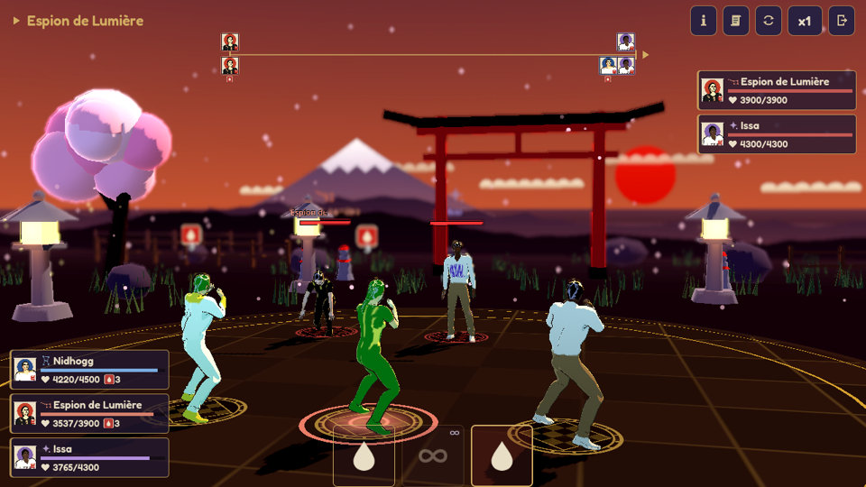
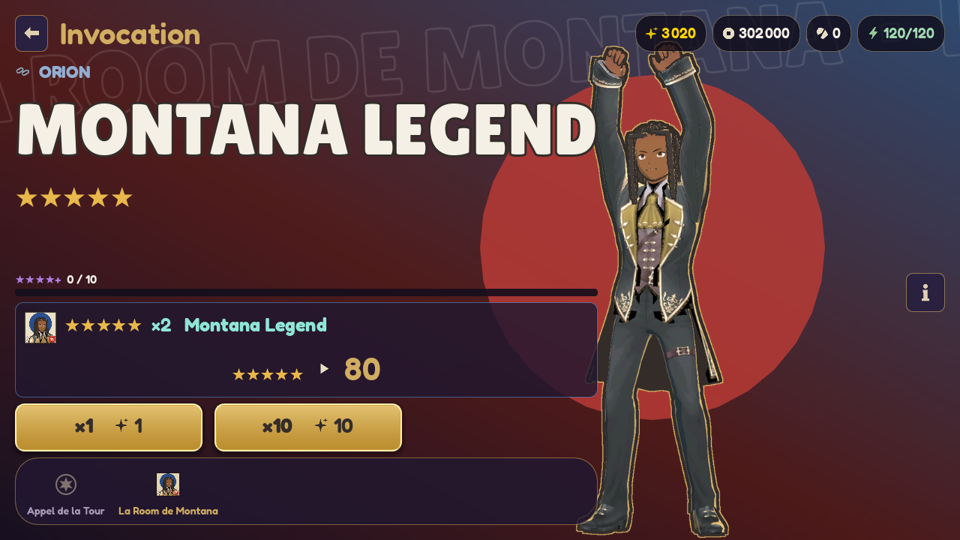
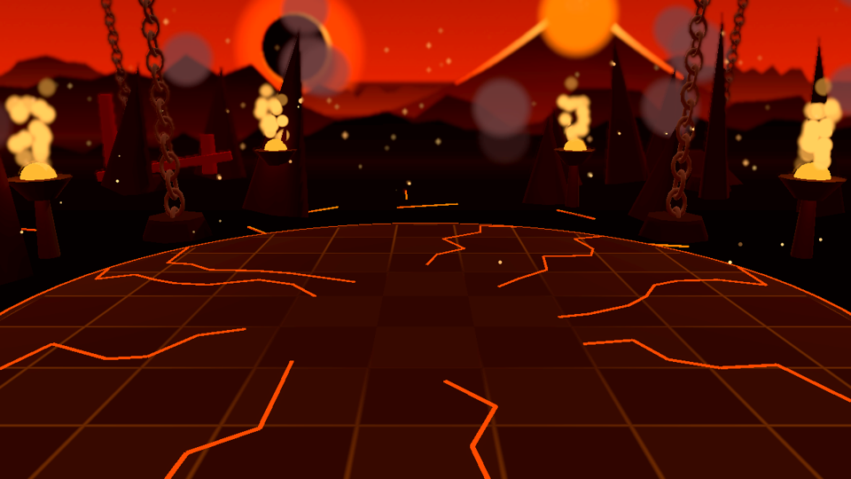
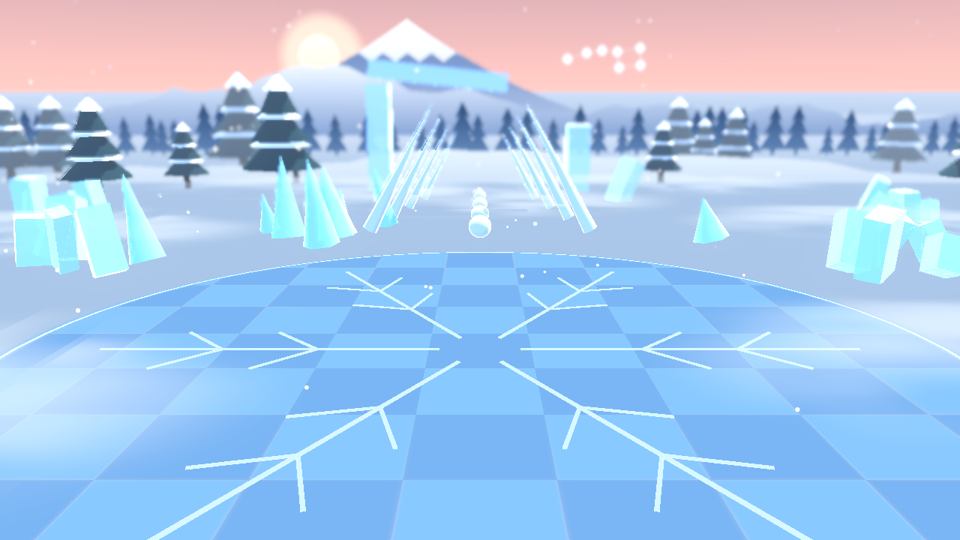
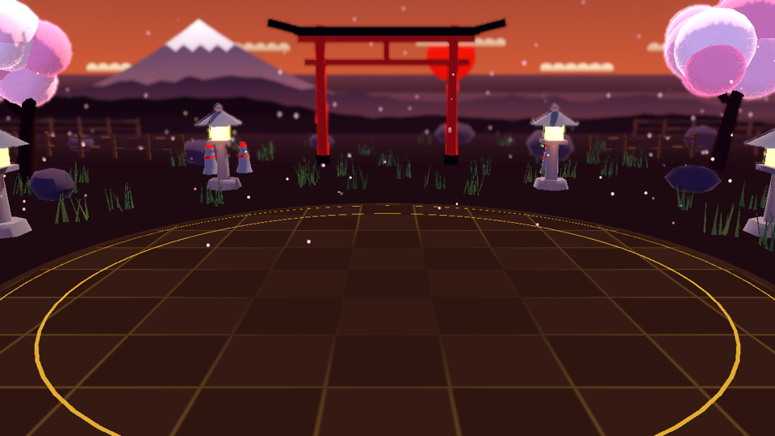
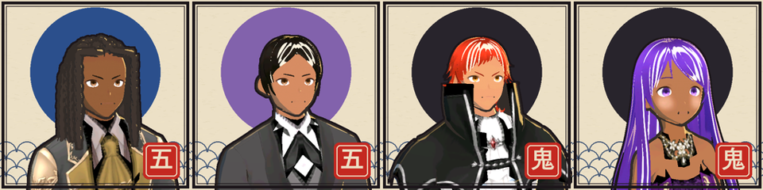
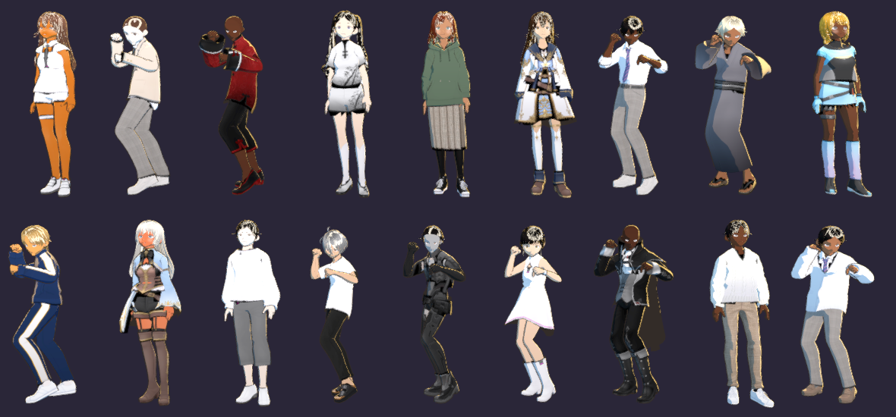
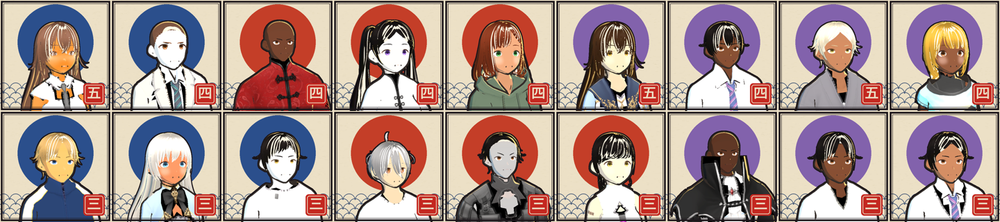

# T99

Gacha RPG mobile au tour par tour (3 contre 3, barre d'action), inspiré de Dislyte, dans un univers
d'estampe japonaise : anime 3D, encre ukiyo-e et symbolique des échecs. Moteur : **Godot 4.7**.
Version actuelle : **v0.15.0** (fichier `VERSION`).

- **Jouer sur Android :** Releases → **[`apk-latest`](../../releases/tag/apk-latest)** (toujours la dernière version).
  L'APK est signé avec une clé fixe : on installe chaque nouvelle version **par-dessus** l'ancienne et la
  sauvegarde est conservée.
- **Jouer sur PC :** `Lancer le jeu.bat` · **Modifier :** `Ouvrir dans Godot.bat`

<p align="center">
  
  
</p>
<p align="center">
  
  
  
</p>
<p align="center"></p>
<p align="center"></p>
<p align="center"></p>

## Ce qu'on peut faire

- **Accueil** en 3D : l'équipe, de dos au pied de la Tour des 99 Étages, lève les yeux vers une tour qui
  se perd dans les nuages ; les modes (Ascension, Invocation, Boss de butin) sont écrits en grand sur la
  tour, Équipe et Collection dans la barre du bas.
- **Prologue** (8 niveaux) dès le début, avec Eiríkr seul : les bases du jeu pas à pas, deux invocations
  x10 offertes sur la bannière « Premier Appel » (Yass, puis Mello à la garantie de 20), et 8 x10 à
  la sortie. La Tour s'ouvre ensuite.
- **Ascension de la Tour** (25 étages) : univers 01, la Cité d'Acier (boss **Prométhée**), et univers 02,
  la Forêt des Gemmes (boss **l'Impératrice Géode**). Combats en **mode tactique** inspiré de Honkai: Star
  Rail : Sceaux d'équipe, ultimes qui coupent la ligne de temps, Ténacité et Rupture par faiblesse de
  constellation, assauts coordonnés, charges de boss télégraphiées, Résonance, 3 étoiles par étage.
  Chaque victoire rapporte des Pièces et une relique, la première des Éclats de Vœu ; énergie, balayage.
- **Boss de butin** : le Chronophage (Orion), le Wyrm de givre (Grande Ourse), le Serpent solaire (Sirius),
  4 paliers (Facile à Enfer), reliques ciblées et garantie après plusieurs victoires.
- **Combats** à la barre d'action : 24 personnages en 3 nations / constellations (triangle Orion › Grande
  Ourse › Sirius), compétences en symboles (appui long pour les lire), ultimes avec gros plan, effets
  visibles, mode auto, vitesse ×1 à ×3, bilan de fin de combat (dégâts, dégâts subis, boucliers, soins).
- **Invocation** façon Dislyte (illustration de la vedette, sélecteur de bannières, taux et garanties)
  avec cinématique sur l'échiquier.
- **Équipe** de 3 et formations, **Collection** (fiche, stats, compétences) et **reliques** (6 emplacements,
  ensembles, niveaux, recyclage).
- Progression **sauvegardée** sur l'appareil.

## Nouveautés récentes

- **v0.15.0** — **Tout le roster est en VRoid** : les 18 derniers personnages (Mikhaïla, Ghost, Tarkhan, Yass, Saraya,
  Noor-El, Jo Prince, Ezra, Flint et les 9 Rares : Eiríkr, Ymir, Nidhogg, Don Diego, Général de Métal, Espion de
  Lumière, Moussa, Issa, Mohamed) ont leur modèle anime et un nouveau portrait en estampe. Les Rares, aussi
  adversaires de la Tour, gardent des tenues simples. GDD mis à jour (direction artistique v0.11 à v0.15).
- **v0.14.0** — Adrian, Mello, Nyssa et Sélène passent en **VRoid**. Interface refondue : boutons principaux or en dégradé, cartes violettes translucides
  (coins de 16 px), ressources en pastilles, police Fredoka 22 px sur les boutons ; chaque bouton grossit au
  survol, s'enfonce avec un clic et rebondit ; fenêtres en fondu + zoom sur fond flouté ; colonne de lumière
  dorée et étincelles sur un tirage 5★. Netteté : rendu 3D à 100 %, MSAA 2× + FXAA, tonemapping Filmic,
  textures VRoid plus fines (yeux en 512 px, compression haute qualité, filtrage anisotrope).
- **v0.13.1** — Caméra cinématique (38°, 3/4 épaule, contre-plongée), étalonnage plus contrasté, ombres
  4096 px, liseré renforcé ; boutons de compétence presque transparents.
- **v0.13.0** — Décors enrichis (torii : rochers, herbes, Jizō, lucioles ; volcan : pics, sanctuaire brisé,
  braises, lave qui pulse ; toundra : sapins, ruines de glace, blizzard, brouillard au sol) et effets de
  pouvoir : arcs de lame à la couleur signature, impacts, tornade de Yass Ming, cristaux de Rupture, aura au
  sol de l'unité qui joue.
- **v0.12** — Don Selah, Prométhée et l'Impératrice Géode refaits dans **VRoid** ; police plus grande et
  plus marquée ; portraits anime.
- **v0.11** — **Montana** refait dans VRoid (locks vanille noires, tenue noir et or) ; ses poursuites sont
  visibles une à une.

## Direction artistique (Bible D.A.)

- **Décors imaginés pour chaque lieu**, en papier découpé façon estampe : Cité d'Acier (pagodes d'acier,
  engrenage géant), forge de Prométhée (éclipse, volcan, chaînes), sanctuaire d'Orion (horloges flottantes),
  lac gelé du Wyrm (monts enneigés, côtes de dragon), désert de Sirius (pyramides, serpent géant), Forêt des
  Gemmes (arbres et cristaux luminescents), cœur de la Géode (améthyste), cour de temple.
- **Personnages en cel-shading** : ombre bleu minéral, liseré d'or, contour à l'encre ; portraits en estampe.
- **Effets à l'encre** : tranchants de pinceau, taches d'encre, sceau doré sous chaque unité, éclair noir et
  blanc sur le coup d'un ultime.
- **Interface sans texte superflu** : ressources, stats et effets en icônes vectorielles ; palette officielle
  indigo `#21172F`, or ancien `#D1AD62`, ivoire `#E8DEC5`, rouge sceau `#B83A35`, bleu minéral `#263C4A`.

## Le pipeline

```
 ┌──────────────────────┐      ┌──────────────────────┐      ┌───────────────────────────┐
 │ MPFB2 (dans Blender) │      │ Mixamo (site web)    │      │ Godot 4.7                 │
 │ fabrique le CORPS    │      │ fournit les          │      │ recible les anims sur     │
 │ de chaque perso +    │      │ ANIMATIONS           │      │ chaque perso (BoneMap),   │
 │ squelette Mixamo     │      │ (idle, coups, KO…)   │      │ fait tourner le JEU       │
 └──────────┬───────────┘      └──────────┬───────────┘      └─────────────▲─────────────┘
            │ assets/models/<id>.fbx      │ assets/mixamo/anims/*.fbx      │
            └─────────────────────────────┴────────────────────────────────┘
```

| Outil | À quoi il sert | Qui |
|---|---|---|
| **VRoid Studio** | Personnages **anime** (Légendaires, boss, puis tout le roster) : modèle piloté par Claude via le MCP `vroid-studio`, export VRM 0.0, puis `tools/vroid/vrm_to_fbx.py` (Blender) le convertit au squelette Mixamo. | Claude + toi : clic « Exporter VRM » |
| **MPFB2** | **MakeHuman dans Blender** : corps 3D de chaque personnage (morphologie, peau, cheveux, vêtements peints) avec un squelette compatible Mixamo, exporté en FBX. | Claude : `tools/mpfb/make_characters.py` + `tools/mpfb/characters.json` |
| **Mixamo** | Bibliothèque d'**animations** (Adobe). Pas d'API : il faut se connecter. | Toi : télécharger les FBX (*Without Skin*) |
| **Godot** | Le **moteur du jeu**. À l'import, il recible les animations Mixamo sur tous les personnages (`assets/mixamo/mixamo_bonemap.tres`). | Claude |
| **GitHub Actions** | Teste le jeu, construit et signe l'**APK** quand `VERSION` change, et le publie dans les Releases. | Automatique |

Détails et commandes (portraits, icônes, décors, shaders, captures) : **`docs/PIPELINE.md`**.

## Contenu du dépôt

| Dossier | Contenu |
|---|---|
| `docs/GDD.md` | Game design : lore, combat, triangle, roster, reliques, gacha, simulations, feuille de route |
| `docs/PIPELINE.md` | Pipeline 3D, icônes, décors, rendu, APK |
| `docs/CAPTOLOGIE.md` | Principes de motivation du joueur (sans manipulation) |
| `data/` | Tout l'équilibrage en JSON (personnages, règles, statuts, gacha, reliques, Tour, boss, progression) |
| `scripts/core/` | Moteur de combat, gacha, reliques, profil, Tour, boss de butin (sans affichage, testable) |
| `scripts/ui/` | Écrans, combat, décors (`battle_decor.gd`), effets (`battle_fx.gd`), `character_model.gd`, `ui_kit.gd` |
| `assets/` | Modèles, animations, portraits, icônes SVG, shaders (`materials/shaders/`), polices, image de bannière |
| `tools/` | Génération (personnages, portraits, icônes, bannière) et outils de contrôle (captures, réglages) |
| `tests/` | Tests des règles et simulations d'équilibrage (headless) |

## Sortir un APK

Changer le numéro dans `VERSION`, committer, pousser sur `main`. On obtient une Release `vX.Y.Z`, et la
Release `apk-latest` est mise à jour.
