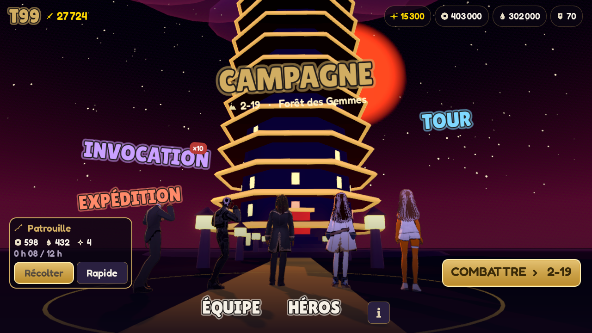
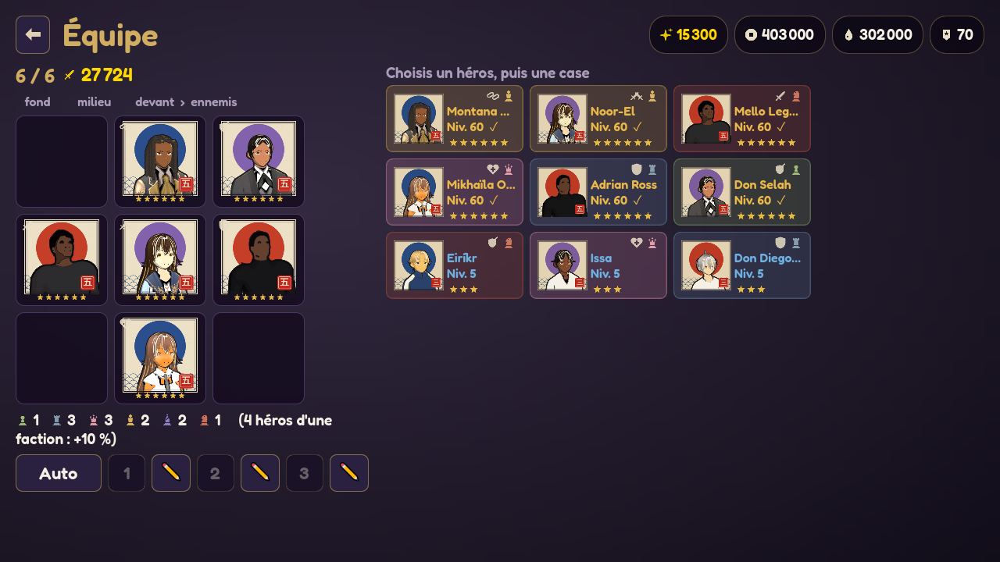
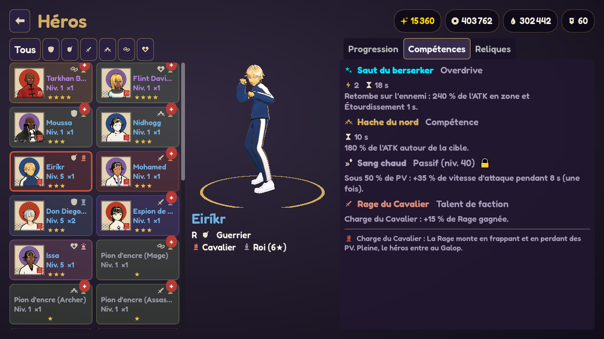

# T99

Gacha RPG mobile **en temps réel** dans un univers d'estampe japonaise (anime 3D, encre ukiyo-e, symbolique
des échecs). Depuis la v0.17, la boucle de jeu reprend celle de **Dragon Traveler** (analyse REA de l'APK :
`docs/ANALYSE_DRAGON_TRAVELER.md`) : 6 héros sur une grille 3 × 3, Overdrive lancés avec une jauge d'énergie
commune, progression par doublons, campagne avec Patrouille hors ligne. Moteur : **Godot 4.7**.
Version actuelle : **v0.18.0** (fichier `VERSION`).

- **Jouer sur Android :** Releases → **[`apk-latest`](../../releases/tag/apk-latest)** (toujours la dernière version).
  L'APK est signé avec une clé fixe : on installe chaque nouvelle version **par-dessus** l'ancienne.
  **La v0.17 repart d'une nouvelle partie** (les sauvegardes d'avant la refonte ne sont pas reprises).
- **Jouer sur PC :** `Lancer le jeu.bat` · **Modifier :** `Ouvrir dans Godot.bat`

<p align="center">
  
  
</p>
<p align="center">
  
  
</p>
<p align="center">
  
  
  
</p>
<p align="center"></p>
<p align="center"></p>
<p align="center"></p>

## Ce qu'on peut faire

- **Combat en temps réel** : jusqu'à 6 héros sur une grille 3 × 3 (Gardiens devant, tireurs et soigneurs
  derrière) avancent et frappent seuls ; touche la carte d'un héros pour lancer son **Overdrive** avec la
  jauge d'énergie commune (ou laisse faire l'AUTO), vitesse ×1 à ×3, pause, bilan de fin de combat.
- **6 classes et 6 factions** (Roi, Cavalier, Fou, Dame, Tour, Pion), chacune avec sa mécanique (réactions
  élémentaires, Rage et Galop, Éveil, Grâce, Châtiment, Promesse) et un bonus à 4, 5 ou 6 héros.
- **Campagne** : 8 chapitres, 240 étapes, boss de fin de chapitre ; la **Patrouille** rapporte Pièces,
  Encre et Essence même jeu fermé (12 h max), Patrouille rapide une fois par jour.
- **La Tour des 99 Étages** (Élites, boss par univers) et l'**Expédition** (boss qui donnent des reliques).
- **Défis** (Défense de la forêt, Casse du trésor, Épreuve de la déesse, Ralliement sauvage) avec vagues
  d'ennemis, classes imposées et balayage quotidien ; **Missions** (héros envoyés en mission) ; **Codex**.
- **Héros** : niveaux 1 à 100 plafonnés par les étoiles, **19 paliers d'étoiles** par doublons (copies,
  héros de la même classe, Pions d'encre et Poupées en remplacement, montée rapide, réinitialisation),
  **Résonance de classe** au-delà du niveau 100, reliques (6 emplacements, sets).
- **Invocation** aux taux de Dragon Traveler (SSR 3 %, garanti en 40 ; bannière limitée garantie en 50),
  liste de souhaits, cinématique sur l'échiquier.
- Progression **sauvegardée** sur l'appareil.

## Nouveautés récentes

- **v0.18.0** — **Nouveaux modes de Dragon Traveler** : **Défis** de la « Conquête des mythes » (Défense de la
  forêt à distance seule, Casse du trésor en mêlée seule, Ralliement sauvage au score avec vagues sans fin,
  Épreuve de la déesse par classe du jour qui donne des Poupées), vagues d'ennemis dans le moteur, **Missions**
  (Dispatch : 4 missions par jour de 1 à 8 h), **Codex** des héros (bonus d'ATK et de PV de compte et Éclats à
  chaque nouvelle étoile).
- **v0.17.0** — **Refonte complète sur le modèle de Dragon Traveler** (analyse REA de l'APK 1.19.0 : tables de
  design SQLite extraites des bundles, voir `docs/ANALYSE_DRAGON_TRAVELER.md`) :
  - **Combat en temps réel** (`scripts/core/rt_battle.gd`) : grille 3 × 3, 6 héros, déplacement et portée,
    compétences automatiques, **Overdrive à coût d'énergie** commune (jauge de 10, ouverture à 6,5 s, délai
    d'équipe), boss qui annoncent leurs coups, nouvel écran de combat de côté avec cartes d'Overdrive.
  - **6 classes, 6 factions** à mécanique propre, bonus de faction, 24 kits réécrits au format DT
    (compétence, Overdrive, passif, talent) + 6 **Pions d'encre** (N) et 5 boss (`docs/KITS.md`).
  - **Progression DT** : niveaux et courbes reprises du jeu, **étoiles par doublons** (19 paliers, de ×0,7 à
    ×2,12), Résonance de classe, Gelée et Poupées ; **invocation** aux taux et garanties de DT.
  - **Campagne + Patrouille idle**, Tour à 99 étages générés, Expédition ; nouveaux écrans (Campagne, Équipe
    en grille, Héros, Invocation, Accueil avec Patrouille).
  - Tests réécrits (6 116 vérifications + simulations d'équilibrage des factions et de la campagne).

- **v0.16.0** — **Mise en scène, audio et systèmes façon Dislyte (analyse REA de `XGame`)** :
  - **Caméra et chorégraphie de combat (`SkillConfig`)** : cadrage dynamique d'impact après le gros plan des ultimes et sur les S2, rotation des attaquants au corps-à-corps vers leur cible (`FaceTargetsCenter`) avec sillage d'élan (`dash_trail`), compteur de **Combo & Dégâts cumulés** en direct et indicateur d'affinité élémentaire (`▲` / `▼` / `★` Rupture) sur le choix des cibles.
  - **Synthétiseur audio procédural (`UiJuicer`)** : effets sonores synthétisés sans fichier externe (coups de lame, impacts taiko, critiques métalliques, bris de cristal de Rupture, ultimes, soins, bonus/malus, fanfare de victoire et cinématique d'invocation).
  - **VFX, décors et shaders enrichis** : couleurs signature pour les 24 héros et les 5 boss, nouveaux VFX 3D de zone (`solar_pillar`, `crystal_eruption`, `void_vortex`), habillage intermédiaire (`_rich` + brouillard au sol) étendu aux 8 arènes (`acier`, `orion`, `sirius`, `gemmes`, `geode`), et frange chaude subsurface + double reflet anisotrope dans `toon_ukiyoe.gdshaderinc`.
  - **Reliques avancées, Résonance d'Étage et Voies** : 4 nouveaux sets de reliques (*Océan*, *Astralis*, *Calamité*, *Égide*), système de **Résonance d'Étage (R1 à R6)** en Collection pour investir les Fragments d'étage des doublons (+4 % PV/ATK/DEF de base par rang), et attribution des 12 Voies et affinités à l'ensemble des 24 personnages.
- **v0.15.0** — **Tout le roster est en VRoid** : les 18 derniers personnages (Mikhaïla, Ghost, Tarkhan, Yass, Saraya,
  Noor-El, Jo Prince, Ezra, Flint et les 9 Rares : Eiríkr, Ymir, Nidhogg, Don Diego, Général de Métal, Espion de
  Lumière, Moussa, Issa, Mohamed) ont leur modèle anime et un nouveau portrait en estampe. Les Rares, aussi
  adversaires de la Tour, gardent des tenues simples. GDD mis à jour (direction artistique v0.11 à v0.15).
- **v0.14.0** — Adrian, Mello, Nyssa et Sélène passent en **VRoid**. Interface refondue : boutons principaux or en dégradé, cartes violettes translucides
  (coins de 16 px), ressources en pastilles, police Fredoka 22 px sur les boutons ; chaque bouton grossit au
  survol, s'enfonce avec un clic et rebondit ; fenêtres en fondu + zoom sur fond flouté ; colonne de lumière
  dorée et étincelles sur un tirage 5★. Netteté : rendu 3D à 100 %, MSAA 2× + FXAA, tonemapping Filmic,
  textures VRoid plus fines (yeux en 512 px, compression haute qualité, filtrage anisotrope).
- **v0.13.1** — Caméra cinématique (38°, 3/4 épaule, contre-plongée), étalonnage plus contrasté, ombres
  4096 px, liseré renforcé ; boutons de compétence presque transparents.
- **v0.13.0** — Décors enrichis (torii : rochers, herbes, Jizō, lucioles ; volcan : pics, sanctuaire brisé,
  braises, lave qui pulse ; toundra : sapins, ruines de glace, blizzard, brouillard au sol) et effets de
  pouvoir : arcs de lame à la couleur signature, impacts, tornade de Yass Ming, cristaux de Rupture, aura au
  sol de l'unité qui joue.
- **v0.12** — Don Selah, Prométhée et l'Impératrice Géode refaits dans **VRoid** ; police plus grande et
  plus marquée ; portraits anime.
- **v0.11** — **Montana** refait dans VRoid (locks vanille noires, tenue noir et or) ; ses poursuites sont
  visibles une à une.

## Direction artistique (Bible D.A.)

- **Décors imaginés pour chaque lieu**, en papier découpé façon estampe : Cité d'Acier (pagodes d'acier,
  engrenage géant), forge de Prométhée (éclipse, volcan, chaînes), sanctuaire d'Orion (horloges flottantes),
  lac gelé du Wyrm (monts enneigés, côtes de dragon), désert de Sirius (pyramides, serpent géant), Forêt des
  Gemmes (arbres et cristaux luminescents), cœur de la Géode (améthyste), cour de temple.
- **Personnages en cel-shading** : ombre bleu minéral, liseré d'or, contour à l'encre ; portraits en estampe.
- **Effets à l'encre** : tranchants de pinceau, taches d'encre, sceau doré sous chaque unité, éclair noir et
  blanc sur le coup d'un ultime.
- **Interface sans texte superflu** : ressources, stats et effets en icônes vectorielles ; palette officielle
  indigo `#21172F`, or ancien `#D1AD62`, ivoire `#E8DEC5`, rouge sceau `#B83A35`, bleu minéral `#263C4A`.

## Le pipeline

```
 ┌──────────────────────┐      ┌──────────────────────┐      ┌───────────────────────────┐
 │ MPFB2 (dans Blender) │      │ Mixamo (site web)    │      │ Godot 4.7                 │
 │ fabrique le CORPS    │      │ fournit les          │      │ recible les anims sur     │
 │ de chaque perso +    │      │ ANIMATIONS           │      │ chaque perso (BoneMap),   │
 │ squelette Mixamo     │      │ (idle, coups, KO…)   │      │ fait tourner le JEU       │
 └──────────┬───────────┘      └──────────┬───────────┘      └─────────────▲─────────────┘
            │ assets/models/<id>.fbx      │ assets/mixamo/anims/*.fbx      │
            └─────────────────────────────┴────────────────────────────────┘
```

| Outil | À quoi il sert | Qui |
|---|---|---|
| **VRoid Studio** | Personnages **anime** (Légendaires, boss, puis tout le roster) : modèle piloté par Claude via le MCP `vroid-studio`, export VRM 0.0, puis `tools/vroid/vrm_to_fbx.py` (Blender) le convertit au squelette Mixamo. | Claude + toi : clic « Exporter VRM » |
| **MPFB2** | **MakeHuman dans Blender** : corps 3D de chaque personnage (morphologie, peau, cheveux, vêtements peints) avec un squelette compatible Mixamo, exporté en FBX. | Claude : `tools/mpfb/make_characters.py` + `tools/mpfb/characters.json` |
| **Mixamo** | Bibliothèque d'**animations** (Adobe). Pas d'API : il faut se connecter. | Toi : télécharger les FBX (*Without Skin*) |
| **Godot** | Le **moteur du jeu**. À l'import, il recible les animations Mixamo sur tous les personnages (`assets/mixamo/mixamo_bonemap.tres`). | Claude |
| **GitHub Actions** | Teste le jeu, construit et signe l'**APK** quand `VERSION` change, et le publie dans les Releases. | Automatique |

Détails et commandes (portraits, icônes, décors, shaders, captures) : **`docs/PIPELINE.md`**.

## Contenu du dépôt

| Dossier | Contenu |
|---|---|
| `docs/GDD.md` | Game design (refonte DT) : combat temps réel, classes, factions, progression, gacha, modes, équilibrage |
| `docs/ANALYSE_DRAGON_TRAVELER.md` | Analyse REA de Dragon Traveler : règles, chiffres, modes, ce qui reste à reprendre |
| `docs/KITS.md` | Kits des 24 héros et des boss (généré depuis `data/heroes.json`) |
| `docs/PIPELINE.md` | Pipeline 3D, icônes, décors, rendu, APK |
| `docs/CAPTOLOGIE.md` | Principes de motivation du joueur (sans manipulation) |
| `data/` | Tout l'équilibrage en JSON (héros, classes, factions, combat, statuts, étoiles, niveaux, gacha, campagne, Tour, Expédition, reliques) |
| `scripts/core/` | Combat temps réel (`rt_battle.gd`), données (`hero_db.gd`), profil, gacha, campagne, Tour, Expédition, reliques (sans affichage, testable) |
| `scripts/ui/` | Écrans, combat, décors (`battle_decor.gd`), effets (`battle_fx.gd`), `character_model.gd`, `ui_kit.gd` |
| `assets/` | Modèles, animations, portraits, icônes SVG, shaders (`materials/shaders/`), polices, image de bannière |
| `tools/` | Génération (personnages, portraits, icônes, bannière) et outils de contrôle (captures, réglages) |
| `tests/` | Tests des règles et simulations d'équilibrage (headless) |

## Sortir un APK

Changer le numéro dans `VERSION`, committer, pousser sur `main`. On obtient une Release `vX.Y.Z`, et la
Release `apk-latest` est mise à jour.
